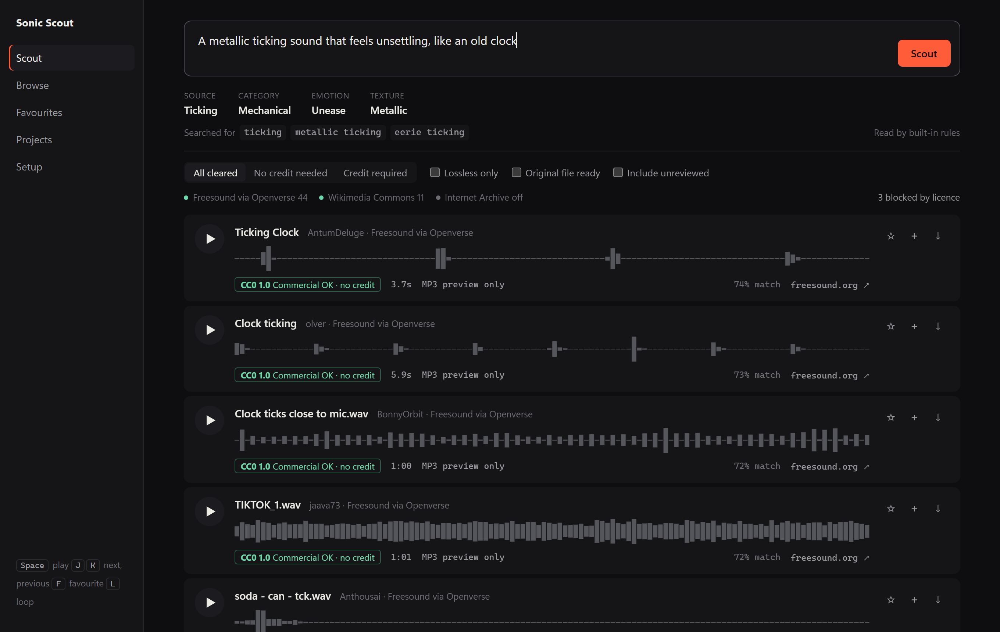
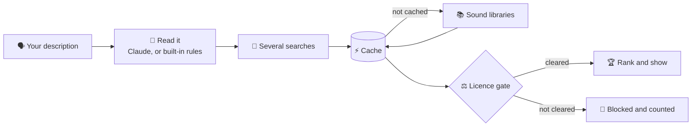
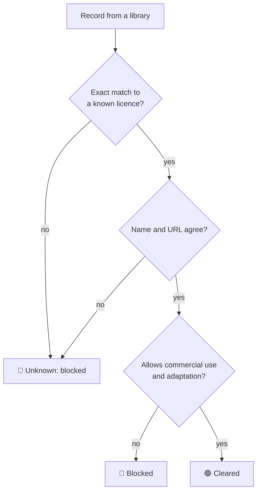
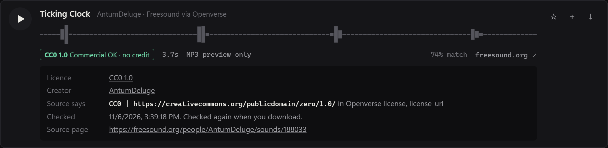
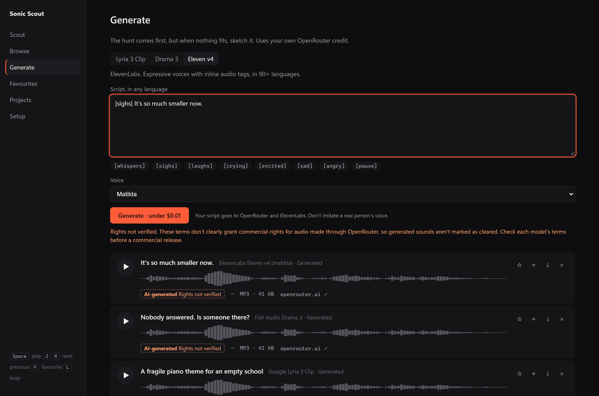
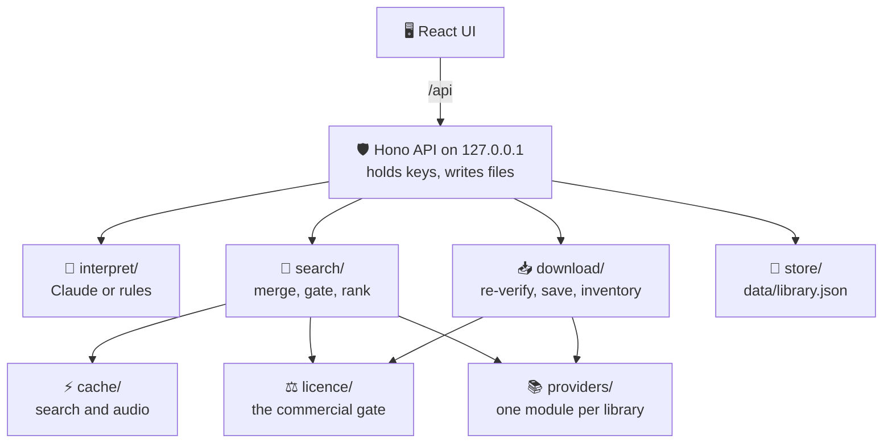

# 🎧 Sonic Scout

**Describe a sound in plain language. Hear real recordings. Know whether you're allowed to use them.**

Sonic Scout searches open sound libraries for film sound designers. It shows you the licence behind every recording, links back to where the sound was posted, and files what you pick into a project folder ready for Ableton Live.

> The machine hunts; the filmmaker chooses.

[](LICENSE)




## ✨ What it does

| | |
| --- | --- |
| 🗣️ **Plain-language search** | "A metallic ticking sound that feels unsettling." It works out the source, mood, texture and length, then runs several searches at once. |
| ⚖️ **A licence gate** | Every result is checked against its real licence. Anything not cleared for commercial use never reaches you, and you can see how many were blocked and why. |
| 📂 **Your own packs too** | Point it at sound packs you've already downloaded, and they appear in the same results as the online libraries. |
| 🔗 **The original page, one click away** | Every card links to the page where the sound was posted, so you can check the creator and the licence yourself. |
| 🎛️ **Generate when nothing fits** | With your own OpenRouter key, sketch music with Lyria 3 Clip and directed voices with Drama 3 and Eleven v4. |
| 🌊 **Real waveforms** | Drawn from the actual audio, never faked. |
| 📁 **Project folders** | Sort sounds into film projects and collections, then save them all at once. |
| 🧾 **A paper trail** | Each project gets a CSV inventory and a `CREDITS.txt` with ready-made credit lines. |
| ⚡ **Caching** | Searches and audio are kept on disk, so a repeat search takes a fraction of a second. |
| 🔒 **Local and private** | Runs on your own machine. Your keys never reach the browser. |

## 🚀 Quick start

You need [Node 22](https://nodejs.org).

```bash
git clone https://github.com/sumit-labz/sonic-scout.git
```

```bash
cd sonic-scout
```

```bash
npm install
```

```bash
npm run dev
```

Open **http://localhost:5173**. It works straight away with no keys. 🎉

To run a built copy on one port, use `npm run build` and then `npm start`, and open http://localhost:5178.

### 🔑 Optional keys

Copy `.env.example` to `.env`, fill in what you have, and restart.

| Key | What it adds |
| --- | --- |
| `FREESOUND_API_KEY` | Direct Freesound search, with no daily Openverse cap. [Apply here](https://freesound.org/apiv2/apply). |
| `FREESOUND_CLIENT_ID` | A "Connect Freesound" link in Setup. **Required for original WAVs from Freesound.** Set the app's callback URL on Freesound to `http://localhost:5178/api/freesound/oauth/callback`, and run `npm run build` once so the callback has a page to land on. |
| `ANTHROPIC_API_KEY` | Claude reads your description instead of the built-in rules. It handles unusual subjects and emotional language far better. |
| `OPENROUTER_API_KEY` | Turns on the **Generate** screen. [Create a key here](https://openrouter.ai/keys). Generating spends your OpenRouter credit. |

## 🔍 How a search works



Cached results still go through the gate, and every download re-reads the record from the library, so a cached licence can never clear a file on its own.

## ⚖️ What is cleared

Every recording passes one gate, in [`server/licence/classify.ts`](server/licence/classify.ts), whatever library it came from.

| Licence | Shown? | Your obligation |
| --- | --- | --- |
| 🟢 CC0, public domain | Yes | None |
| 🟡 CC BY | Yes | Credit the creator. `CREDITS.txt` has the lines ready. |
| 🟠 CC BY-SA | No, unless `ALLOW_SHARE_ALIKE=true` | Commercial use is allowed, but syncing audio to picture can count as an adaptation, so ShareAlike may reach your film. |
| 📂 A licence you declared for your own folder | Yes, labelled as your declaration | Whatever that licence says. See [Your own sound folders](#-your-own-sound-folders). |
| 🔴 CC BY-NC, BY-NC-SA, BY-NC-ND | Never | |
| 🔴 CC BY-ND | Never | Forbids adaptations, which covers sound design. |
| 🔴 Sampling+, personal use, unknown, conflicting data | Never | |



The rules it follows:

- 📜 The licence comes from the library's own fields, never from an AI description. The exact value is kept as evidence.
- ❓ Anything that doesn't match a known licence exactly is treated as unknown. So is a record whose licence name and URL disagree.
- 🔁 Downloads re-read the record from the library. The browser cannot supply a licence or a file URL.
- 📊 Every search reports how many matches were blocked, and why.



> ⚠️ **What this cannot do.** A licence is a claim by the uploader. Sonic Scout proves the library says so, not that the uploader owned the recording. The moderated libraries lower that risk but don't remove it, and a recording of a voice, brand or copyrighted music can carry separate rights. **This isn't legal advice.** For a commercial release, keep the inventory CSV and have someone review anything important.

## 📚 Sound libraries

| Library | Key | Originals | Notes |
| --- | --- | --- | --- |
| Freesound direct | API key | WAV and more, after you connect an account | 60 requests a minute, 2,000 a day. Original downloads 30 a minute, 500 a day. |
| Freesound via Openverse | None | MP3 preview only | Used when there is no Freesound key. 20 requests a minute, 200 a day, and each search uses up to four. |
| Wikimedia Commons | None | Yes | Most of its audio is CC BY-SA, so much of it is blocked. |
| Internet Archive | None | Yes, often WAV | **Off by default.** Tick "Include unreviewed" to search it. |
| Your folders | None | Yes, your own files | Off until you add a folder in Setup. Filenames never leave your computer. |

**Why Internet Archive is opt-in.** Uploaders pick their own licence and nobody checks it. Testing turned up ripped video-game audio marked "public domain". Its results carry an orange badge, and the inventory records them as `unreviewed uploader claim`.

**Investigated and left out:**

- **Pixabay:** its API covers only images and videos, so reaching its audio would mean scraping.
- **NASA:** has no per-item licence field, so there is no evidence to record.
- **SFXMint, Lotsofsounds:** only their own marketing claims back the licensing.

**Freesound API terms.** The API terms are separate from each sound's licence and say commercial use of the API is negotiated case by case. Using a sound commercially under its licence is one thing. Selling Sonic Scout itself as a product would need an agreement with Freesound.

## 📂 Your own sound folders

Some of the best free collections have no API, such as the [Sonniss GDC bundles](https://sonniss.com/gameaudiogdc). Download a pack yourself, then add its folder under **Setup → Your sound folders**. Its sounds appear in your normal search results.

**You declare the licence, because audio files don't carry one.** Choose one for each folder:

| Choice | Result |
| --- | --- |
| Sonniss GDC bundle | Shown, no credit needed. |
| My own recordings | Shown, no credit needed. |
| CC0 | Shown, no credit needed. |
| CC BY | Shown, credit required. Asks for the creator and a web link, so the credit line is complete. |
| Another licence | Shown. Asks for its name and a link to its text, and for you to confirm it allows commercial use in a film. |
| Not sure yet | **Blocked**, and counted with the other blocked sounds, until you add the folder again with a licence. |

> ⚠️ **Sonic Scout can't check what you declare.** These results carry a dashed badge reading "Your declaration", and the inventory records `declared by you for this folder`. A folder of sounds from different sources needs the licence that fits all of them, so split it up or leave it as "Not sure yet".

**Sonniss terms, from licence v2.0 (27 August 2026).** Commercial use and syncing to film are allowed, without credit. You can't redistribute the sounds themselves, even modified ones, or use them to train or build AI. These terms cover the GDC bundles only, so check any other pack's licence. If a bundle comes with a newer licence, read that one.

**How it works:**

- 🗂️ Your files stay where they are. Saving a sound copies it to your project folder, byte for byte, and removing a folder from Sonic Scout never deletes anything.
- 🔒 Filenames stay on your computer. They aren't sent to any library or to Claude, which only sees what you type.
- 🔎 Search matches filenames and folder names, so well-named packs work best.
- 🔄 Press **Rescan** after adding or changing files. Each file can belong to only one folder, so overlapping folders are refused.
- ⛓️ Links and shortcuts are skipped, and up to 200,000 sounds are indexed per folder.
- 🎧 WAV, FLAC, MP3, OGG and M4A play in the app. AIFF files can be found and saved but won't play in Chrome or Edge, so audition those in Ableton.

## 🎛️ Generate

When the libraries don't have it, sketch it. Add `OPENROUTER_API_KEY` to `.env`, restart, and open **Generate**.



*Layout only: this screenshot uses placeholder audio, so the waveforms match.*

> 🧪 **Early feature.** This has been tested against a stand-in built from OpenRouter's docs, not live models yet. Lyria's audio response isn't documented, so please open an issue if a model misbehaves.

| Model | Good for | Controls | Listed price |
| --- | --- | --- | --- |
| 🎵 **Lyria 3 Clip** (Google) | 30-second music sketches | Mood, instruments, BPM, instrumental only, seed, and a picture to set the mood | $0.04 a clip |
| 🎭 **Drama 3** (Fish Audio) | Directed performances | `[direction]` buttons in the script, direction for the whole take, Fish voice id | $2 per million bytes |
| 🗣️ **Eleven v4** (ElevenLabs) | Expressive voices in many languages | Audio tag buttons, 21 voices | $80 per million characters |

- 💸 The button shows an estimate before you spend anything. A failed request is never retried automatically, and a double click can't pay twice.
- 🧾 Takes are stored in `data/generated`, with the exact prompt and generation id. Star them, add them to projects and save them like any other sound.
- 🔇 Generated sounds never appear in search, because search only shows cleared sounds.
- 🎤 Don't imitate a real person's voice. Sonic Scout has no voice cloning, and the providers forbid doing this without consent.

> ⚠️ **Rights are not verified.** Generated audio is labelled **AI-generated, rights not verified**, in the app and in the inventory, and it is never marked as cleared. OpenRouter's terms hand output rights to each model's own terms. ElevenLabs and Fish Audio tie commercial use to paid plans, and it isn't clear how that applies to routed access. Fish Audio's terms don't state who owns output. Check each model's terms, or ask a lawyer, before a commercial release.

> 🔒 **Privacy.** Your prompts, and any picture you add, go to OpenRouter and the model's maker. Google, Fish Audio and ElevenLabs have their own rules on using that content, and some allow training on it. Don't paste anything confidential.

## ⚡ Caching

These libraries are free services, so Sonic Scout tries not to ask them twice.

| What | Where | Kept for |
| --- | --- | --- |
| 🔎 Search answers | `data/cache/search.json` | Used directly for a day. Up to 7 days, shown at once and refreshed in the background. |
| 🎵 Preview audio | `data/cache/audio/` | Up to 1 GB. The least recently used goes first. |
| 🌊 Waveform outlines | Your browser | Until you clear site data. |

- If a library rate-limits you, cached answers keep working, and Sonic Scout backs off for as long as the library asks.
- Failures are never cached.
- Waveforms for Wikimedia Commons and Internet Archive are drawn when you first play the sound. Both serve whole original files and run on donations.
- Your own folders aren't cached. They're searched directly from an index in `data/local-index.json`, so a rescan shows up at once.
- To clear everything on disk, delete `data/cache`.

The first search for something new still has to wait for the libraries, which took 4 to 7 seconds in testing.

## 🎹 Using it

- **Keys:** `Space` play or pause, `J` next, `K` previous, `F` favourite, `L` loop.
- **Source link:** click `freesound.org ↗` on any card to open the page where the sound was posted.
- **Your folders:** cards from your own folders have no source link, because they have no page on the web. If you gave a CC BY folder a link, it appears in the credit line.
- **Waveforms** are decoded from the real audio. A flat line means the file hasn't been played yet, couldn't be measured, or is over 20 MB.
- **"% match"** scores the recording's title, tags and description against your request. It cannot hear the audio, so trust your ears.
- **"Lossless"** describes the file format, not the recording. Some old Commons WAVs are as low as 8 kHz, so check the sound before relying on it.

## 🎚️ Ableton workflow

Files are saved like this, with the creator's original filename and bytes untouched:

```
<download folder>/
  The Man Inside His Head/
    sonic-scout-inventory.csv
    CREDITS.txt
    Childhood Memories/
      school_bell.wav
```

Add the download folder to **Places** in Ableton's browser, then drag sounds into your set. Sonic Scout never touches Ableton projects.

The inventory lists the source page, creator, licence, the evidence and when it was checked, plus a SHA-256 of each file.

## 🏗️ Architecture



The server only listens on loopback, and rejects other hosts and origins, so websites can't drive it. Keys stay in `.env` and never reach the browser.

## 🤝 Contributing

Contributions are welcome, especially new sound libraries.

To add a library, implement `SoundProvider` in `server/providers/` and register it in `registry.ts`. The gate applies automatically. Add its audio host to the proxy allowlist in the same file, and set `reviewed` honestly.

A library needs three things to qualify:

1. ✅ A public API. No scraping, and no getting around logins or terms.
2. ✅ A licence on each recording, in the data itself.
3. ✅ Terms that allow this use.

Before opening a pull request, run:

```bash
npm test
```

```bash
npm run typecheck
```

## 🗺️ Not built yet

Deliberately left for later: emotion-first search, Ableton transformation suggestions, scene mode, and Ableton sample collection export.

## 📄 Licence

The **code** is [MIT](LICENSE) licensed, free for anyone to use and change.

That covers Sonic Scout only. **Each sound keeps its own licence**, set by its creator, and this repository contains no recordings. Check the licence on every sound you use, and credit the creators who ask for it. 🙏

Thanks to the people who record and share these sounds, and to [Freesound](https://freesound.org), [Openverse](https://openverse.org), [Wikimedia Commons](https://commons.wikimedia.org) and the [Internet Archive](https://archive.org) for making them findable.
